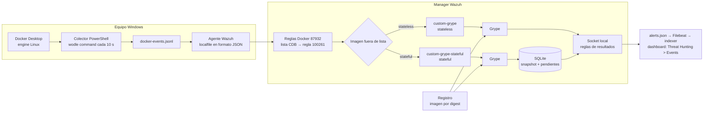

# Docker en Windows + Grype para Wazuh

Prueba de concepto: cuando alguien descarga una imagen Docker en un equipo Windows con Docker Desktop, Wazuh lo detecta, el manager analiza la imagen con Grype y el resultado aparece como alertas en el dashboard.

Hay dos modos de análisis:

- **Stateless:** cada análisis avisa de todos los hallazgos, aunque ya se hubieran visto.
- **Stateful:** el manager recuerda en SQLite lo ya visto de cada imagen y avisa solo de lo nuevo o cambiado, más un resumen.

> Es una PoC de laboratorio, no una solución de producción. Los [límites](docs/resultados-y-limites.md) están documentados.

## Cómo funciona



Grype y SQLite viven en el manager. El manager obtiene la imagen del registro por digest, así que no necesita acceso al engine Docker del equipo Windows. El endpoint solo usa PowerShell, Docker CLI y su agente.

## Activar el colector como wodle

El colector no se lanza ni se para a mano: el agente lo ejecuta solo, cada 10 s, desde su `ossec.conf`. Resumen (pasos completos, comprobaciones y marcha atrás en [docs/wodle.md](docs/wodle.md)):

1. Copiar [collector-windows-wodle.ps1](windows/collector-windows-wodle.ps1) a una carpeta que solo puedan modificar administradores y SYSTEM (por ejemplo `C:\WazuhPoC\wodle`) y crear `C:\WazuhPoC\runtime`.
2. Hacer copia del `ossec.conf` del agente y añadir, dentro de `<ossec_config>`, el [`<localfile>`](windows/localfile.ejemplo.xml) y este `<wodle>` (con la misma ruta de `-LogPath` en los dos):

   ```xml
   <wodle name="command">
     <disabled>no</disabled>
     <tag>docker-events</tag>
     <command>C:\Windows\System32\WindowsPowerShell\v1.0\powershell.exe -NoProfile -NonInteractive -ExecutionPolicy Bypass -File "C:\WazuhPoC\wodle\collector-windows-wodle.ps1" -LogPath "C:\WazuhPoC\runtime\docker-events.jsonl"</command>
     <interval>10s</interval>
     <run_on_start>yes</run_on_start>
     <timeout>60</timeout>
     <ignore_output>yes</ignore_output>
   </wodle>
   ```

3. Reiniciar el agente (PowerShell como administrador): `Restart-Service WazuhSvc`.
4. Comprobar: `docker --context desktop-linux pull alpine:3.21` debe añadir una línea nueva a `docker-events.jsonl` en 10 s como máximo.

Para pausarlo sin quitarlo, la documentación oficial del wodle `command` ofrece `<disabled>yes</disabled>` y reiniciar el agente (no probado en este laboratorio). No ejecutar el colector original a la vez: duplicaría los eventos.

## Contenido

| Ruta | Qué es |
|---|---|
| [windows/collector-windows-wodle.ps1](windows/collector-windows-wodle.ps1) | Colector de eventos Docker pensado para el wodle `command`: cada ejecución recoge los eventos nuevos y termina. |
| [windows/wodle.ejemplo.xml](windows/wodle.ejemplo.xml) | Bloque `<wodle>` para el `ossec.conf` del agente. |
| [windows/localfile.ejemplo.xml](windows/localfile.ejemplo.xml) | Bloque `<localfile>` que lee el JSONL del colector. |
| [windows/original/collector-windows.ps1](windows/original/collector-windows.ps1) | Colector continuo original (captura de hasta 3600 s). Se conserva como referencia. |
| [manager/comun/](manager/comun) | `custom-grype` (lanza Grype y valida el informe), `grype-poc.yaml`, reglas 100261-100276 y lista CDB de imágenes permitidas. |
| [manager/stateless/](manager/stateless) | Configuración de la integración stateless. |
| [manager/stateful/](manager/stateful) | Wrapper stateful, almacén SQLite, configuración, reglas 100280-100287 y pruebas aisladas. |
| [docs/](docs) | Guía de instalación, wodle, demostración, resultados y pruebas. |

## Empezar

1. **Manager:** instalar integración, reglas, lista y Grype según la [guía de laboratorio](docs/guia-lab.md).
2. **Agente Windows:** activar el colector como wodle ([resumen arriba](#activar-el-colector-como-wodle); detalle en [docs/wodle.md](docs/wodle.md)).
3. **Probar:** seguir el [guion de demostración](docs/demo.md).
4. **Revisar la lógica sin Docker ni Wazuh:** [pruebas aisladas](docs/pruebas-aisladas.md).

## Versiones ensayadas

Son versiones observadas, no una matriz de compatibilidad certificada.

- Windows 11 Pro, Windows PowerShell 5.1.
- Docker Desktop 4.93.0, Engine 29.8.1, engine Linux amd64 sobre WSL2.
- Manager Wazuh 4.14.8 en un contenedor Docker.
- Grype 0.121.0 en el manager (la configuración rechaza otra versión).

## Resultados

Comparación con `alpine:3.19` y la misma base de Grype (27 de octubre de 2026):

| Modo | Primer pull | Segundo pull | Avisos de hallazgos |
|---|---:|---:|---:|
| Stateless | 14 hallazgos | 14 repetidos | 28 |
| Stateful | 14 nuevos | 0 nuevos; 14 sin cambios | 14 |

Los 14 hallazgos correspondían a 6 identificadores de vulnerabilidad distintos. La tabla cuenta avisos de hallazgos, no los eventos resumen de cada análisis. Con el colector como wodle, ejecutado por el agente como LocalSystem, un pull llegó a la alerta de política en unos 4 s y al resumen de Grype en unos 11 s (una sola medición). Detalle y límites en [docs/resultados-y-limites.md](docs/resultados-y-limites.md).

## Límites principales

- Solo se dispara con un `pull` fuera de la lista CDB; no hay escaneo periódico ni inventario de contenedores.
- Stateful no emite alertas de «resuelta»: «ya no observado» no significa corregido.
- La memoria se identifica por el digest, no por el tag. Si un tag como `latest` pasa a otra imagen, cuenta como nueva y los hallazgos de la anterior no se cierran.
- Un análisis cada vez: los concurrentes se rechazan, sin cola.
- Son alertas JSON propias, no el inventario nativo de Vulnerability Detection.
- El JSONL del colector no se rota.
- Podman y macOS no están validados.

## Seguridad

- El wodle lo ejecuta el agente como **LocalSystem**. Instalar el script en una carpeta que solo puedan modificar administradores y SYSTEM; si no, cualquier proceso de usuario podría ejecutar código como SYSTEM. [Instrucciones](docs/wodle.md#instalación).
- Restringir también la escritura del JSONL: quien pueda escribirlo puede fabricar eventos que el manager tratará como del endpoint.
- El análisis se limita a `docker.io/library/alpine`, `nginx` y `busybox` (`allowed_repositories` en la configuración). No hay mecanismo ensayado para imágenes privadas.
- No se expone la API de Docker por TCP: el colector usa el named pipe local.
- El repositorio no incluye binarios ni caché de Grype, SQLite real, registros de eventos, credenciales ni copias de `ossec.conf`.

## Procedencia y licencia

`collector-windows-wodle.ps1` deriva de `windows/original/collector-windows.ps1`; la lógica de identidad de la imagen es la misma. Los archivos del manager conservan sus bytes originales, porque `custom-grype` y `grype-poc.yaml` tienen el SHA256 fijado en `custom-grype-stateful.json`. Por eso `.gitattributes` desactiva la conversión de saltos de línea.

Licencia: [MIT](LICENSE).
